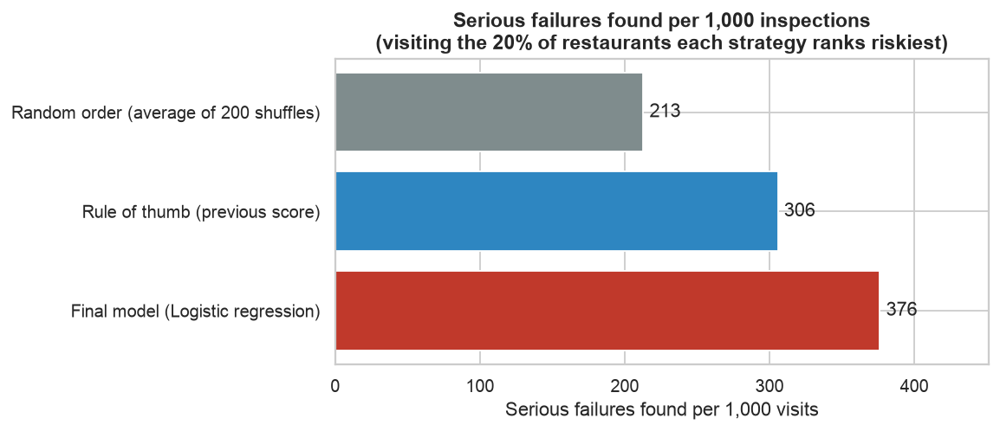
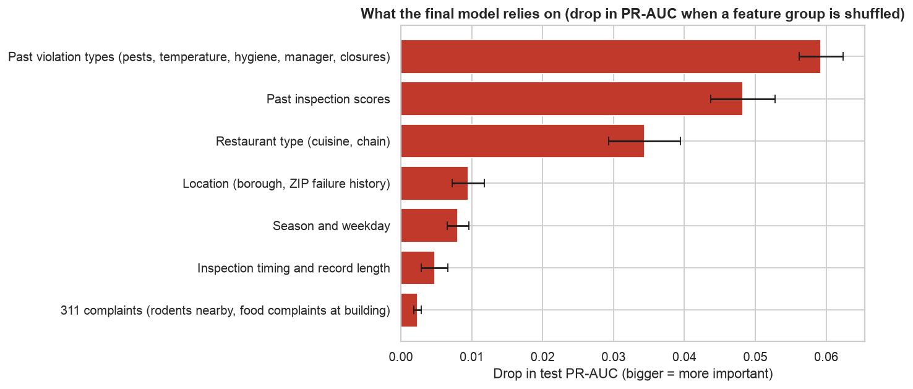
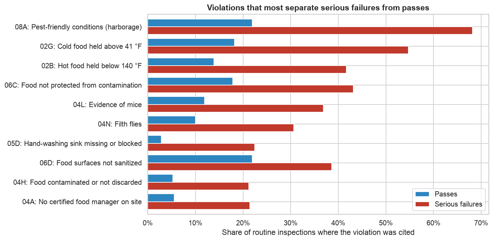
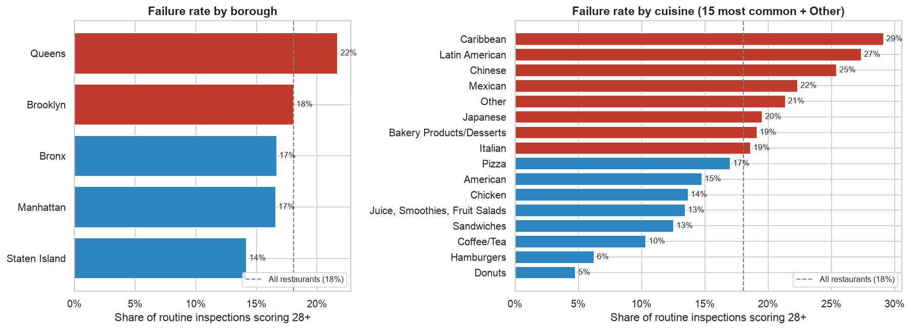
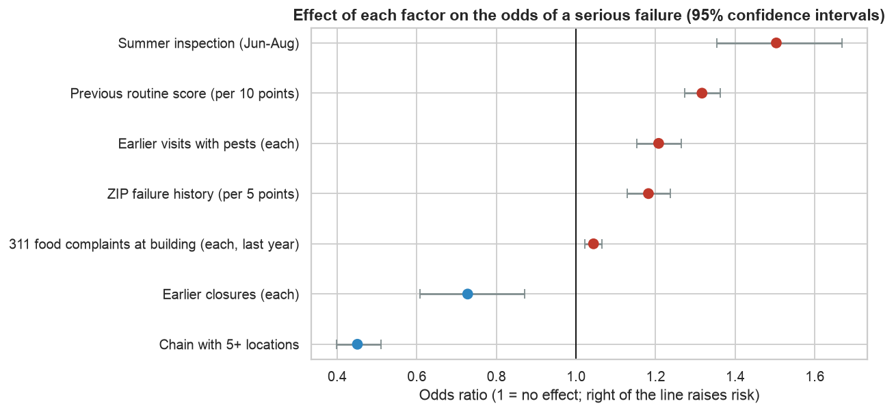
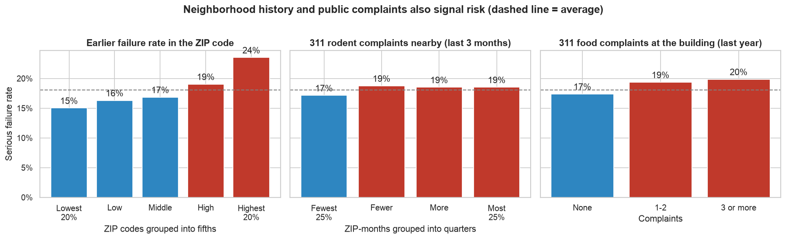
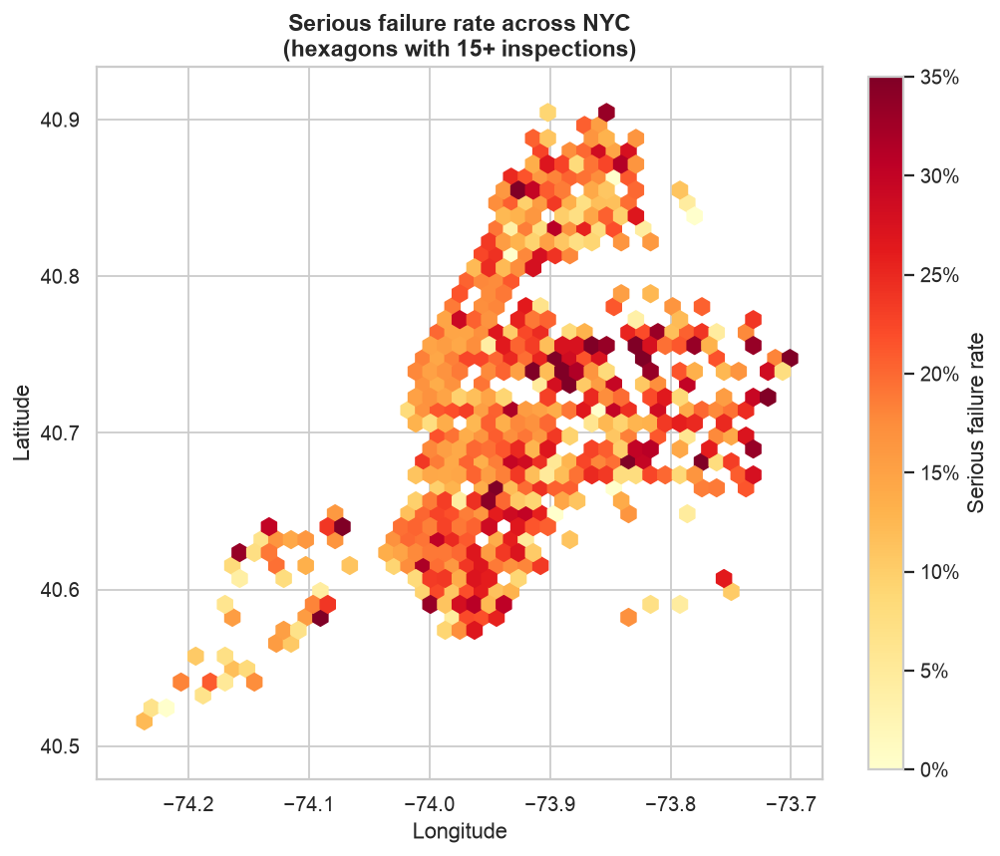
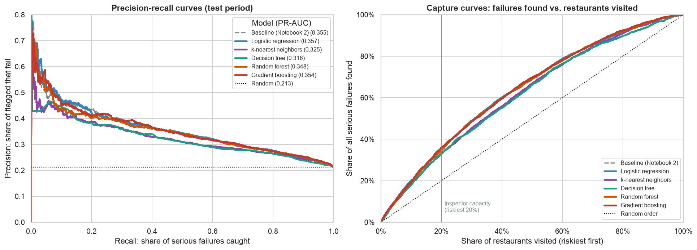
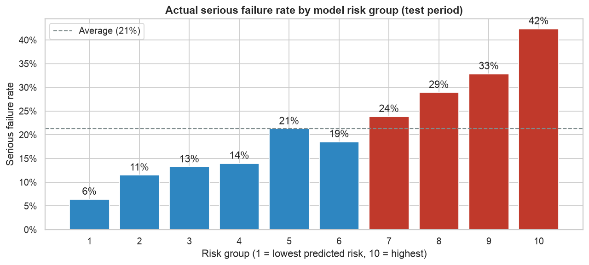

### NYC Food Safety Inspection Model, Part 2: Which Restaurants Should Inspectors Visit First?

**Vyom Rawat**

*UC Berkeley Professional Certificate in Machine Learning and Artificial Intelligence, Capstone Project (Final Report). This is Part 2 of the project. Part 1, the initial report and exploratory analysis, is in [nyc-food-safety-inspection-eda](https://github.com/VyomR/nyc-food-safety-inspection-eda).*

#### Executive summary

**The problem.** New York City inspects more than 27,000 restaurants with a limited number of health inspectors. Today, how soon a restaurant is inspected again depends mostly on its last score, so a restaurant that passed last time but has started cutting corners can go many months unchecked.

**The question.** Using only information available *before* an inspector walks in, can we tell which restaurants are most likely to **seriously fail** their next routine inspection (28 or more violation points, the range that earns a C grade)?

**What I did.** I studied 46,000 routine inspections from January 2022 to October 2026, added public 311 complaints, and built and compared five prediction models. Every model was tested the way it would really be used: trained on the past, then asked to rank the most recent six months of inspections, which it had never seen.

**What I found.**
* **Past behavior is the best predictor.** Restaurants with earlier high scores, pests or food-temperature problems are much more likely to fail again.
* **Independent restaurants, certain cuisines and summer inspections carry more risk.** Chains have less than half the odds of failing; inspections in June to August have 50% higher odds.
* **A simple, explainable model works as well as complex ones.** The final model is a logistic regression, a transparent scoring method whose reasons can be shown to inspectors and restaurant owners.

**Why it matters.** Looking back at the six-month test period: if inspectors had started with the 20% of restaurants the model ranks riskiest, **376 of every 1,000 visits** would have found a serious failure. That compares with **306** for the rule of re-visiting the worst previous scores, and about **213** for random visits. Over that period, that is **130 more serious failures found than the rule of thumb (+23%)** with the same number of inspections. A live pilot is the next step to confirm the gain.



#### Rationale

Foodborne illness makes about 48 million Americans sick each year, sends about 128,000 to hospital and kills about 3,000 (CDC estimates). Restaurants are a common source. Every serious failure that is found later than it could have been is a period in which diners are exposed to pests, contaminated food or food held at unsafe temperatures.

If this question goes unanswered, inspectors keep spending visits on clean kitchens while risky ones wait. A ranked "visit these first" list, built from data the city already publishes, lets the Health Department find more problems with the inspectors it already has. It also gives restaurant owners clear warning signs they can fix before an inspection.

#### Research Question

Using only information available before an inspection, can we predict which New York City restaurants will receive a **serious failing score (28 points or more)** at their next routine health inspection, well enough to help the Health Department decide whom to inspect first?

#### Data Sources

| Source | What it contains | How it is used |
|---|---|---|
| [DOHMH Restaurant Inspection Results](https://data.cityofnewyork.us/Health/DOHMH-New-York-City-Restaurant-Inspection-Results/43nn-pn8j) (NYC Open Data) | 294,406 violation records for 31,369 restaurants: inspection date and type, score, violations, cuisine, location | The outcome to predict, and each restaurant's inspection history |
| [311 Service Requests](https://data.cityofnewyork.us/Social-Services/311-Service-Requests-from-2010-to-Present/erm2-nwe9) (NYC Open Data) | Rodent complaints by ZIP code and month; 84,131 food-establishment and food-poisoning complaints with building IDs | Neighborhood conditions and complaints about the restaurant's building |

All files are snapshots from 25 October 2026, stored in `data/raw/` so the results can be reproduced.

**Cleaning and preparation** (details in [Notebook 1](notebooks/01_data_cleaning_and_eda.ipynb)):
* Removed 217 duplicate rows, 3,917 placeholder rows for restaurants not yet inspected, and thinly covered years before 2022.
* Fixed invalid locations and borough codes by filling them from the ZIP code; dropped 311 complaints without a valid building ID.
* Combined the violation rows into 91,745 inspections and kept the **routine, unannounced first visit** of each inspection cycle as the moment to predict: **46,000 inspections of 22,033 restaurants**. 18% of them were serious failures.
* Investigated outliers: very high scores (up to 157 points) are real, so they were kept; 77 inspections scoring 0 despite critical violations are impossible and were removed as data-entry errors.
* Built 25 features, each using **only information from before the inspection date**: earlier scores and violation types (pests, temperature, hygiene, closures), time since the last inspection, cuisine, chain size, borough, month, the ZIP code's earlier failure rate, nearby rodent complaints and food complaints at the building.

#### Methodology

1. **Exploration and statistics.** Charts of failure rates by every factor; statistical tests to check which differences are real rather than chance; and a logistic regression with confidence intervals to measure how large each effect is.
2. **Fair testing over time.** Models learned from inspections between January 2022 and April 2026 and were tested on the most recent six months (April to October 2026, 9,226 inspections). This mimics real use and prevents the model from "seeing the future".
3. **Five models compared.** Logistic regression, k-nearest neighbors, decision tree, random forest and gradient boosting (see the glossary below). Each was tuned with **grid search**, which tries many combinations of settings, and **5-fold time-ordered cross-validation**, which repeatedly trains on earlier data and checks on later data. The baseline from Part 1 was the benchmark to beat.
4. **How success was measured.** Only about 1 in 5 inspections is a serious failure, so "accuracy" is misleading: a model that predicts "pass" for everyone is right about 80% of the time and catches nothing. Instead:
   * **PR-AUC** is the main score. It measures how well real failures are concentrated at the top of the ranked list: a random ranking scores about 0.21 here and a perfect one 1.0.
   * **Results at inspector capacity** translate it into practice. If inspectors visit the riskiest 20% of restaurants first, two numbers matter: the **share of all serious failures they find**, and the **hit rate**, meaning how many of those visits find a failure (shown as failures per 1,000 visits).
5. **Choosing the final model.** The top three models scored within normal variation of each other. I therefore chose the simplest model whose score was statistically as good as the best, which is logistic regression.

#### Results

##### Finding 1: Past behavior is the strongest warning sign


Restaurants whose last routine score was 42 or more fail again **36%** of the time, against **12%** after an A-range score. Restaurants cited for pests before fail **23%** of the time vs **13%**. In the model, earlier violation types and earlier scores are by far the most important inputs:



When restaurants do fail seriously, these are the violations most often cited, led by conditions that attract pests and food held at unsafe temperatures:



> **Action:** treat a history of pests and food-temperature violations as a priority signal, not just the last letter grade.

##### Finding 2: Who and when, as well as what

* **Chains fail far less often:** 9% vs 20% for independent restaurants.
* **Cuisine matters:** Caribbean (29%), Latin American (27%) and Chinese (25%) restaurants fail most often; donut (5%), hamburger (6%) and coffee shops (10%) least. This likely reflects kitchen complexity and chain ownership more than the food itself.
* **Summer is the riskiest season.**



The chart below shows how much each factor changes the odds of a serious failure when the others are held constant. Every effect is statistically significant (p < 0.001), and the bars show the range of plausible values (95% confidence intervals):



* Every 10 extra points on the last routine inspection: **+32% odds**.
* Each earlier visit with pests: **+21% odds**.
* Summer inspection (June to August): **+50% odds**.
* Chain with 5 or more locations: **-55% odds**.
* Earlier closures: **-27% odds** once past scores and pests are taken into account. Restaurants that were closed fail more often overall, but among restaurants with *equally bad* records, those that were closed and reopened do slightly better. The closure forces repairs and brings close follow-up. This is an association, not proof of cause.

> **Action:** schedule higher-risk independent restaurants **before summer**, and offer pest-control guidance or earlier follow-ups to repeat pest offenders.

##### Finding 3: Neighborhood and 311 complaints help only a little

Restaurants in the ZIP codes with the highest earlier failure rates fail 24% of the time vs 15% in the lowest, and buildings with three or more 311 food complaints fail slightly more often (20% vs 17%). But once a restaurant's own record is known, these add little: the final model scores 0.357 with them and 0.354 without.



Failure rates vary block by block rather than along borough lines, with clusters in parts of Queens and south Brooklyn:



##### Finding 4: A simple model is as good as complex ones

| Model | Cross-validation PR-AUC | Test PR-AUC | Share of serious failures found visiting the riskiest 20% |
|---|---|---|---|
| **Logistic regression (final)** | 0.302 | **0.357** | **35%** |
| Baseline (Part 1) | 0.297 | 0.355 | 35% |
| Gradient boosting | 0.302 | 0.354 | 36% |
| Random forest | 0.307 | 0.348 | 35% |
| k-nearest neighbors | 0.286 | 0.325 | 33% |
| Decision tree | 0.273 | 0.316 | 33% |
| *Random order* | *0.17* | *0.21* | *20%* |



The stronger models perform almost identically, so the limit is the information available before an inspection, not the choice of algorithm. A transparent logistic regression is therefore the best choice for a public agency. Every score can be explained, for example: "two earlier pest violations, summer inspection, independent restaurant".

##### Finding 5: The model sorts restaurants into clear risk tiers



In the test period, the 10% of restaurants the model rated riskiest failed **42%** of the time; the 10% rated safest failed **7%** of the time. Individual results are still uncertain: in the test period, even the single highest-risk restaurant passed. The model is a tool for **prioritizing** visits, not for judging any single restaurant.

##### What this means for the Health Department

| Recommendation | Why |
|---|---|
| **Pilot a monthly risk ranking and visit the top of the list first**, within the existing inspection cycle | Looking back, it ranked 23% more serious failures into the top 20% than re-visiting the worst previous scores; a pilot confirms the real-world gain |
| **Move high-risk inspections ahead of summer** | Summer inspections have 50% higher odds of a serious failure |
| **Follow up early with repeat pest offenders** | Each earlier pest visit raises the odds by about a fifth |
| **Show the reasons behind each ranking** | The model is transparent, which supports fairness and lets owners know what to fix |
| **Retrain the model at least every quarter** | Failure rates were higher in 2026 than in earlier years, so the model's risk levels drift if it is not updated |

#### Next steps

* **Pilot** the ranking in one borough for a few months and compare the serious failures found against business as usual.
* **Check fairness**: confirm the ranking does not target restaurants by cuisine or neighborhood beyond what their own records justify, by comparing hit rates across groups.
* **Add richer data** the city holds but does not publish (inspector notes, complaint details, ownership changes), which could break through the limit the public data seems to set.
* **Monitor and retrain** regularly as conditions change.

#### Glossary

| Term | Plain meaning |
|---|---|
| Logistic regression | A scoring formula that adds up weighted risk factors into a probability; each factor's weight can be read directly |
| Decision tree / random forest / gradient boosting | Models built from yes/no questions ("pests last time?"), used alone (tree) or combined in large numbers (forest, boosting) |
| k-nearest neighbors | Predicts risk from the most similar past restaurants |
| PR-AUC | How well real failures rise to the top of a ranked list; 0.21 is random here, 1.0 is perfect |
| Cross-validation | Repeatedly training on one part of the past and testing on a later part, to check results are stable |
| Odds ratio | How a factor multiplies the odds of failing; 1.5 means 50% higher odds, 0.5 means half |
| Confidence interval | The range of plausible values for an effect, given the data |
| Statistically significant | Very unlikely to be a coincidence |

#### Outline of project

- [Notebook 1: Data cleaning, EDA and feature engineering](notebooks/01_data_cleaning_and_eda.ipynb)
- [Notebook 2: Baseline model (from Part 1)](notebooks/02_baseline_model.ipynb)
- [Notebook 3: Model comparison with grid search and cross-validation](notebooks/03_model_comparison.ipynb)
- [Notebook 4: Interpretation, statistical inference and recommendations](notebooks/04_interpretation_and_recommendations.ipynb)

```
├── README.md
├── requirements.txt
├── data
│   ├── raw/          # NYC Open Data snapshots (inspections, 311 rodent and food complaints)
│   └── processed/    # modeling table created by Notebook 1
├── images/           # figures used in this README
├── models/           # final model and its settings, created by Notebook 3
└── notebooks/        # run in order: 01 → 02 → 03 → 04
```

**To reproduce:** `pip install -r requirements.txt`, then run the notebooks in order from the `notebooks/` folder.

##### Contact and Further Information

Vyom Rawat · [GitHub: VyomR](https://github.com/VyomR)
